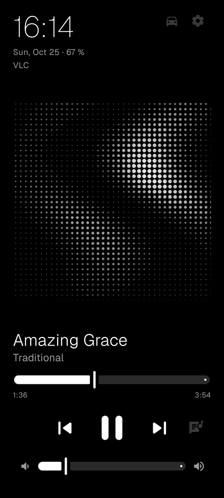
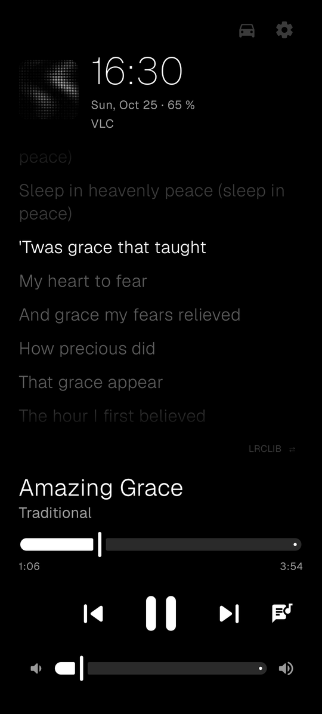
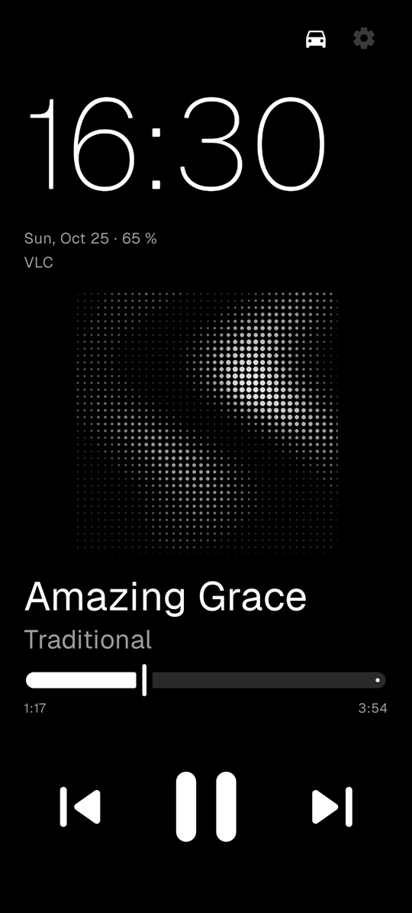
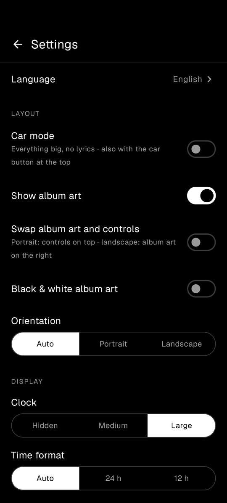
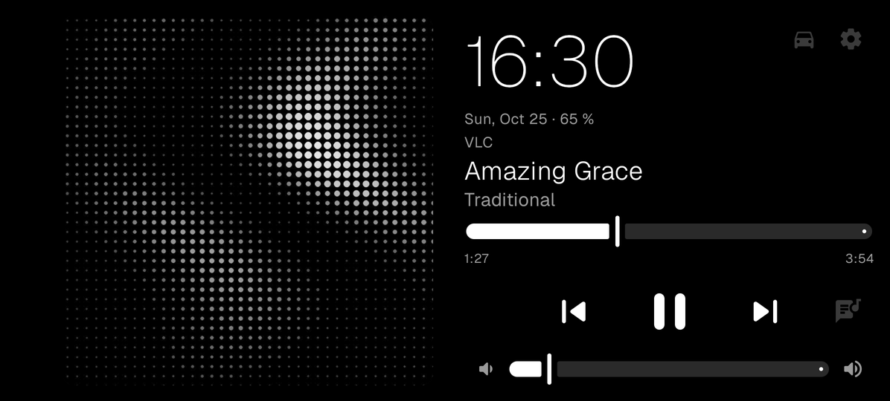
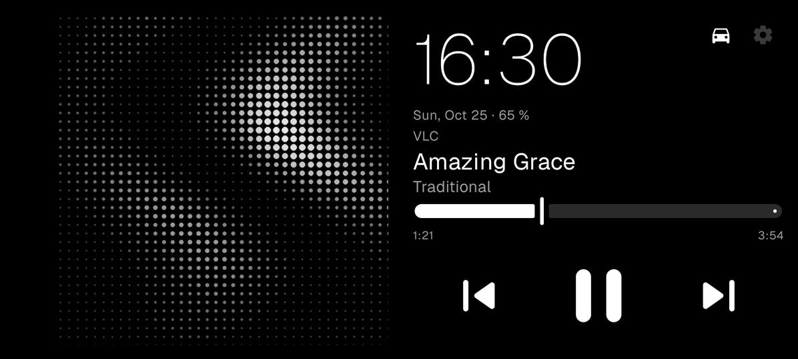

<p align="center"></p>

# Noir Music

An always-on, pure black & white music controller for Android, built for AMOLED screens.

<p align="center">
  
  
  
  
</p>
<p align="center">
  
  
</p>
<p align="center"><sub>Screenshots use a public-domain track (Amazing Grace) with homemade cover art.</sub></p>

Noir Music doesn't play music itself: it shows and controls whatever is playing in your other apps (Deezer, Spotify, YouTube Music…) on a minimal full-screen display, meant to stay on next to your desk or in the car.

## Download

- **GitHub**: the signed APK is attached to each [release](https://github.com/BabasGames/noir-music/releases/latest).
- **F-Droid**: submission in progress. Once accepted, the app will be at [f-droid.org/packages/fr.babas.noir](https://f-droid.org/packages/fr.babas.noir/).

## Features

- **Controls**: play/pause, previous/next, seek, volume, and the app's own ♥ button when it exposes one. Swipe left/right to change track.
- **Synced lyrics**: swipe up to show lyrics that follow the music (tap a line to jump there, swipe up again for full screen), from [LRCLIB](https://lrclib.net), with NetEase as an optional fallback (off by default). Downloaded lyrics are kept for offline use.
- **Car mode**: huge clock, big buttons at the bottom, no lyrics to keep your eyes on the road.
- **Made to stay on**: keeps the screen awake while music plays, reduced refresh rate on the player, periodic pixel shifting against burn-in, night mode (always, on a schedule or in the dark), standby screen when nothing plays, sleep timer, optional screen saver for charging docks and display over the lock screen.
- **Clock**: system fonts or your own font file, 12/24 h, localized date, and it fits next to the camera hole (detected automatically, set by hand, or none for under-display cameras).
- **Source picker**: switch between the apps that have a media session, or pin a preferred one.
- **14 languages**: English, French, Spanish, German, Italian, Portuguese, Dutch, Polish, Turkish, Russian, Ukrainian, Japanese, Chinese, Korean.

See **[FEATURES.md](FEATURES.md)** for the full list.

## Gestures

| Gesture | Action |
|---|---|
| Swipe left / right | Next / previous track |
| Swipe up / down | Show lyrics, then full-screen lyrics / go back |
| Tap the title | Play / pause |
| Double tap | ♥ (when the playing app supports it, outside the lyrics) |
| Tap a lyrics line | Jump to that moment |
| Long press | Open the playing app |
| Tap the clock | Sleep timer |
| Tap the app name | Switch source |

## Compatibility

Requires Android 10 or newer. Tested on Android 17; older versions should work but haven't been tested yet, so feedback is welcome.

## Permissions

| Permission | Why |
|---|---|
| Notification access | The only way Android lets an app see and control other apps' media sessions. Noir Music never reads your notifications. |
| Internet, network state | Fetching lyrics, and knowing whether you are on mobile data (lyrics downloads can be limited to Wi-Fi). |
| Query all packages | Showing the name of the playing app and listing music apps for the "preferred app" setting. |

No account, no analytics, no ads. The only network requests are lyrics lookups (title, artist and duration of the current track) sent to LRCLIB, and to NetEase only if you enable the fallback source.

## Building

Requirements: JDK 17 or newer and the Android SDK (platform 35).

```sh
./gradlew assembleDebug     # installable debug build
./gradlew assembleRelease   # release build, unsigned unless a signing key is configured
```

APKs end up in `app/build/outputs/apk/`. To sign release builds, add these properties to `~/.gradle/gradle.properties` (never to the repo): `noirKeystore`, `noirKeystorePassword`, `noirKeyAlias`, `noirKeyPassword`.

`release.sh [vX.Y.Z]` builds the release APK from a clean clone of a tag (the latest one by default) into `dist/`. Release APKs are reproducible: built this way, they match F-Droid's build apart from the signature.

`install.sh [IP:PORT]` builds a release, installs it over ADB (optionally connecting to a wireless-debugging address first), grants notification access and starts the app.

## Lyrics disclaimer

Lyrics come from community-maintained databases. They may be out of sync or not match the song, and Noir Music has no control over their content. The optional NetEase fallback uses an unofficial API of a non-free service, and may stop working at any time.

## License

Copyright © 2026 BabasGames

Noir Music is free software: you can redistribute it and/or modify it under the terms of the GNU General Public License as published by the Free Software Foundation, either version 3 of the License, or (at your option) any later version. Any distributed copy or derivative must keep this notice, credit the original author, and be released under the same license with its source code.

This program is distributed in the hope that it will be useful, but WITHOUT ANY WARRANTY; without even the implied warranty of MERCHANTABILITY or FITNESS FOR A PARTICULAR PURPOSE. See [LICENSE](LICENSE) for the full text.
